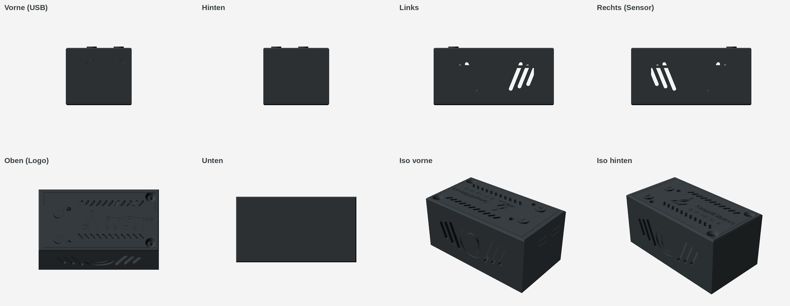

# Smartfitness-bridge-case

Case for Freenove ESP32-S3 dev board with TOF sensor – 3D-druckbares Gehäuse im Bauhaus-Stil für ein **Freenove ESP32-S3-WROOM** (FNK0085, 2× USB-C) und einen **TOF400C / VL53L1X** Distanzsensor, passend zu [hubwerk/Smartfitness-bridge](https://github.com/hubwerk/Smartfitness-bridge).



Außenmaß: **71,2 × 38,9 × 34 mm**

## Dateien

| Datei | Beschreibung |
|---|---|
| `gehaeuse.scad` | Parametrisches OpenSCAD-Modell (alle Maße oben in der Datei) |
| `logo_smartfitness.scad` | Logo-Polygone aus dem Webinterface |
| `gehaeuse_unterteil.stl` | Unterteil |
| `gehaeuse_deckel.stl` | Deckel mit graviertem Logo und Schriftzug „SmartFitness BRIDGE“ |
| `taster_b.stl`, `taster_r.stl` | Tasterkappen mit vertiefter Kennzeichnung „b“ / „r“ |
| `deckel_logo_einlage.stl` | Optionale Einlage für Mehrfarbdruck (0,6 mm) |
| `ansichten/` | Renderings aus allen Richtungen |

## Aufbau

- Sensor hochkant mittig in der Längsseite, Kappe außen bündig. **Gewinkelte Stiftleiste** am Sensor verwenden; die Dupont-Stecker laufen flach an der Wand entlang.
- USB-C-Buchsen bündig mit der Stirnseite. Das Board wird eingelegt und zur USB-Wand geschoben; ein Riegel am Deckel sichert es.
- Der Deckel hakt vorn unter die USB-Wand und wird hinten mit 2× M3-Senkkopfschrauben befestigt.
- Kennzeichnung der Taster: „b“ = BOOT, „r“ = RESET. Bitte die Zuordnung zum Board prüfen und bei Bedarf `btn_labels` tauschen.

## Vor dem Druck nachmessen

Positionen von Tastern und LEDs (`buttons`, `leds`), USB-Position und -Überstand (`usb_y`, `usb_ov`), Höhe der Sensorkappe (`cap_h`) und Maße der gewinkelten Stiftleiste (`tof_plug`, `tof_plug_len`).

## Exportieren

```sh
openscad -D 'part="box"'        -o gehaeuse_unterteil.stl   gehaeuse.scad
openscad -D 'part="lid"'        -o gehaeuse_deckel.stl      gehaeuse.scad
openscad -D 'part="btn_b"'      -o taster_b.stl             gehaeuse.scad
openscad -D 'part="btn_r"'      -o taster_r.stl             gehaeuse.scad
openscad -D 'part="logo_inlay"' -o deckel_logo_einlage.stl  gehaeuse.scad
```

Renderings in Anthrazit: `ansichten/anthrazit.json` nach `color-schemes/render/` von OpenSCAD kopieren und mit `--colorscheme=Anthrazit --render` rendern.
