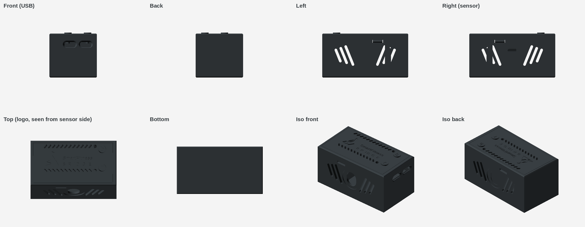
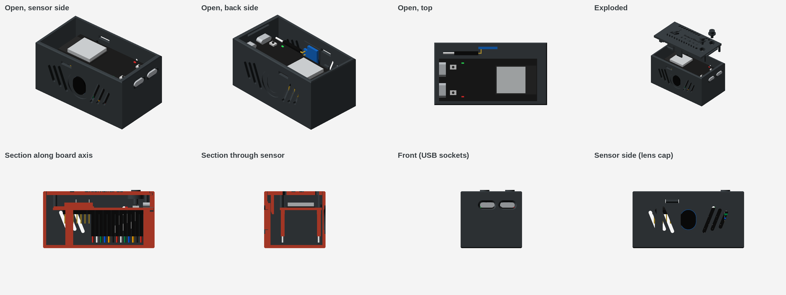
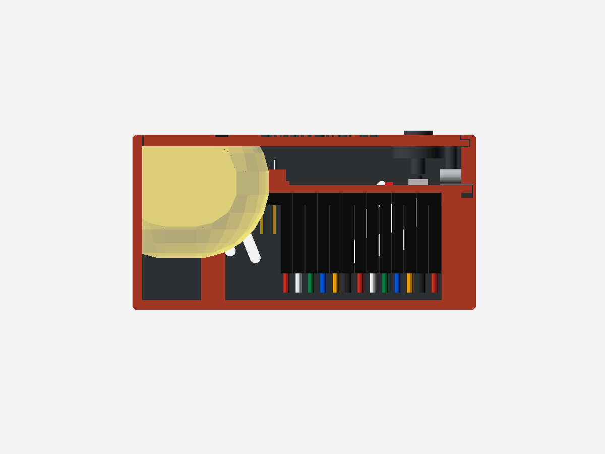

# Smartfitness-bridge-case

Case for the Freenove ESP32-S3 dev board with a TOF sensor: a 3D-printable Bauhaus-style enclosure for the **Freenove ESP32-S3-WROOM** (FNK0085, 2× USB-C) and a **TOF400C / VL53L1X** distance sensor, made for [hubwerk/Smartfitness-bridge](https://github.com/hubwerk/Smartfitness-bridge).



Outer dimensions: **70.5 × 38.9 × 36 mm**

## Files

| File | Description |
|---|---|
| `enclosure.scad` | Parametric OpenSCAD model (all dimensions at the top of the file) |
| `logo_smartfitness.scad` | Logo polygons taken from the web interface |
| `enclosure_base.stl` | Base |
| `enclosure_lid.stl` | Lid with engraved logo and "SmartFitness BRIDGE" lettering |
| `button_b.stl`, `button_r.stl` | Button caps with recessed "b" / "r" labels |
| `lid_logo_inlay.stl` | Optional inlay for multi-color printing (0.6 mm) |
| `views/` | Renderings from all directions |

## Renderings with electronics



Open, exploded and sectioned views with simplified placeholders for the board, the TOF400C (upright, right-angle header) and the Dupont plugs are in `views/electronics/`.

## Design

- The sensor sits upright in the middle of the long side, its lens cap flush with the outside. Use a **right-angle pin header** on the sensor so the Dupont plugs run flat along the wall.
- The USB-C sockets are flush with the end face. The openings have a 1 mm 45° outer chamfer (`usb_chamfer`) to guide the plug and leave room for thicker plug housings. Drop the board in and slide it toward the USB wall; a latch on the lid holds it in place.
- The lid hooks under the USB wall at the front and snaps into both side walls with two plastic latches (no screws). The latch windows go through the wall, so a thin pin can release them.
- 22 mm clearance under the board (`esp_under`): straight Dupont sockets fit, with about 5.5 mm below them for the wires to bend inward. The free channel between the pin rows is about 20 mm wide.
- On the lid, the vent slot rows continue the LED lines and the logo sits on the board axis between them, in line with the buttons.
- Logo, lettering and button labels read correctly when looking at the case from the sensor side (`read_rot`).
- Button labels: "b" = BOOT, "r" = RESET. Check the mapping against your board and swap `btn_labels` if needed.

## Antenna clearance

The ESP32-S3-WROOM PCB antenna sits at the board end opposite the USB sockets, right at the rear wall (6.7 mm from the outer surface).

- No screws, metal parts or cables in the case. The lid is held by plastic latches, which sit outside the 15 mm zone.
- Within 15 mm of the antenna area there is only plastic: the rear wall, two narrow corner latches behind the board end, and the board support just in front of the antenna.
- The TOF board and its plugs are 17.9 mm from the antenna. The sensor wires run toward the USB end.
- **Only use the first 13 pins of each header row, counted from the USB end** (`pins_ok`). Leave the 7 pins at the antenna end unplugged so that no Dupont plug or wire comes within 15 mm of the antenna.
- `enclosure.scad` prints these distances (`echo`) and stops with an `assert` if anything gets closer than `ant_clear`.



*Section along the board axis: the yellow zone marks 15 mm around the antenna area.*

## Measure before printing

Button and LED positions (`buttons`, `leds`), USB position and overhang (`usb_y`, `usb_ov`), sensor cap height (`cap_h`), the right-angle header dimensions (`tof_plug`, `tof_plug_len`), and the length of the antenna area on the module (`ant_len`).

## Export

```sh
openscad -D 'part="box"'        -o enclosure_base.stl   enclosure.scad
openscad -D 'part="lid"'        -o enclosure_lid.stl      enclosure.scad
openscad -D 'part="btn_b"'      -o button_b.stl             enclosure.scad
openscad -D 'part="btn_r"'      -o button_r.stl             enclosure.scad
openscad -D 'part="logo_inlay"' -o lid_logo_inlay.stl  enclosure.scad
```

The renderings hide the board and sensor placeholders; set `show_electronics = true` to show them. `show_ant_zone` shows the antenna clearance zone. `lid_lift` (exploded view, `-1` hides the lid) and `cut` (`"xz"` / `"yz"` section) are only used for renderings.

Anthracite renderings: copy `views/anthracite.json` into OpenSCAD's `color-schemes/render/` folder and render with `--colorscheme=Anthracite --render`.
